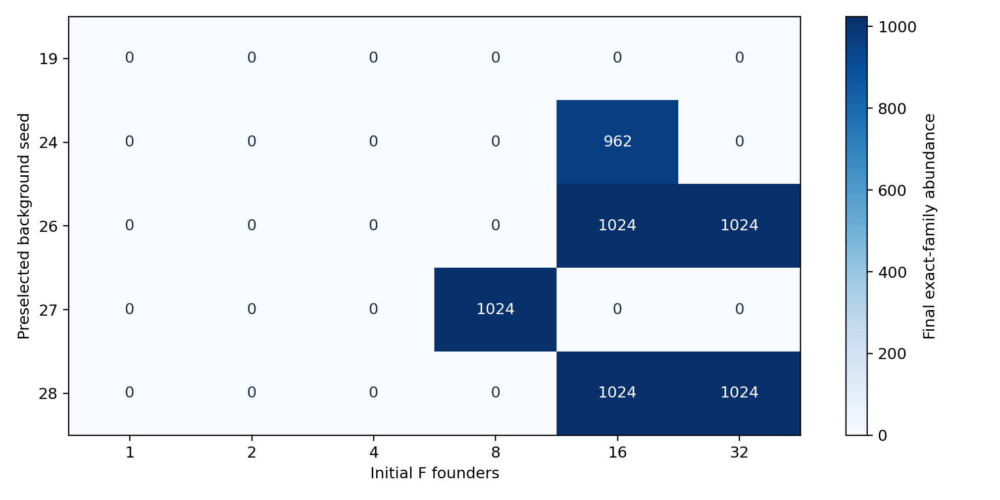
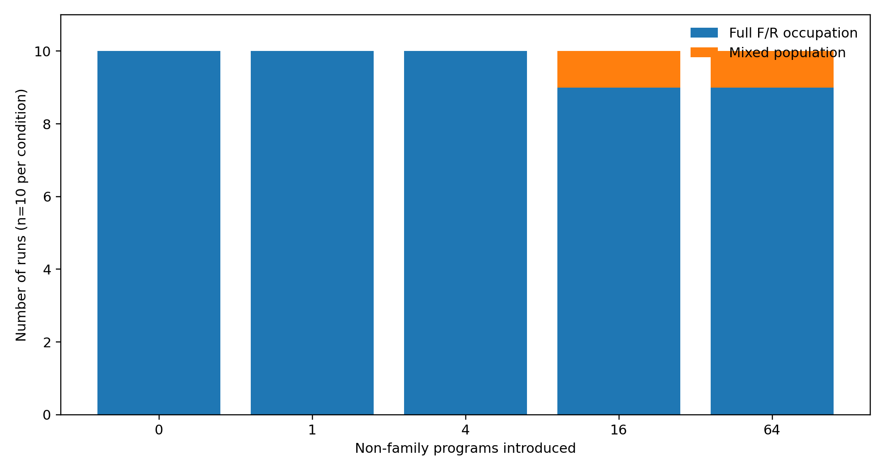
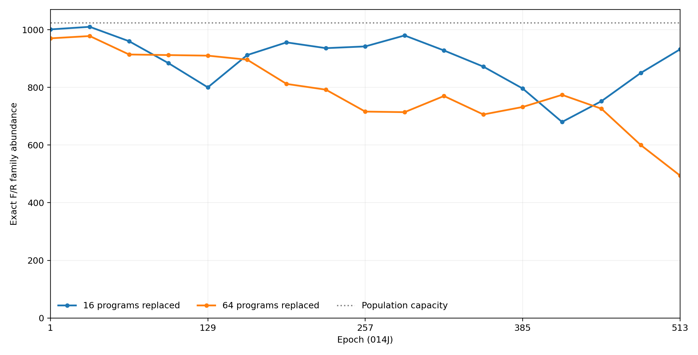
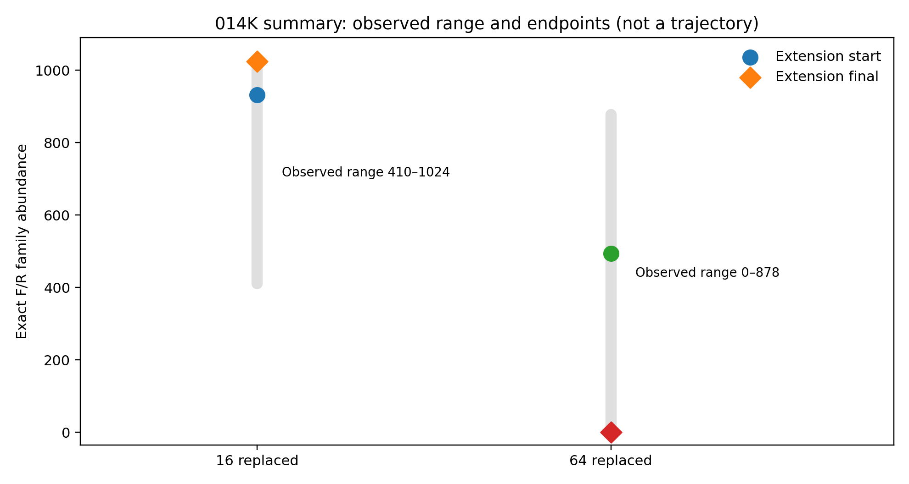

# Research Note 003

## Replication, Population Takeover, and Recovery in a Mutation-Free Computational Substrate

**ABIO — Computational Abiogenesis Research Program**  
**November 3, 2026**  
**Status:** Completed experimental investigation; implementation and reproducibility audit pending  
**Research phase:** Experiment 014 (phases B–K)  
**System:** BFF (`bff_noheads`), instrumented `cubff`  

### Abstract

We investigate the population-level behavior of a 64-byte computational sequence and its byte-reversed counterpart in a pairwise-interaction BFF substrate. Earlier controlled tests identified copying interactions and established that the two-sequence family could expand in mixed populations. We examine the outcomes of population establishment, complete occupation, and deliberate perturbation under zero externally specified mutation probability. Among 30 founder-density trials across five previously successful background seeds, six populations retained family members at the final checkpoint and five reached complete family occupation. Direct tests of all four possible family-family pairings showed that both outputs remained in the two-sequence family, providing a candidate mechanism for absorbing-state persistence. In 40 perturbation trials starting from a fully occupied population, 38 ended with complete family occupation after 512 epochs; the other two remained mixed. Extending those two configurations for another 2,048 epochs yielded one complete recovery and one extinction of the tracked family. These results demonstrate conditional persistence and recovery of a defined computational replicator family, not spontaneous abiogenesis, metabolism, open-ended evolution, or Darwinian adaptation.

### 1. Research question

Research Note 001 characterized sequence persistence and mutation transmission in extracted BFF lineages. [Research Note 002](../publication002/002-functional-heredity.md) subsequently established controlled multigenerational functional heredity and nonuniform mutational tolerance in selected reproductive configurations. Neither controlled assay established whether a replicator family could persist in a mixed, interacting population. Here we address that ecological question. The present experiments do not test the spontaneous generation of heritable variation or population-level natural selection.

Can a computational replicator family not only increase in number, but also persist, take over a finite population, and recover after competitors are introduced? We distinguish (i) replication and amplification, (ii) closure and persistence after takeover, and (iii) recovery following perturbation.

### 2. System and operational definitions

The substrate is the `bff_noheads` language in the `cubff` engine. The population consists of 1,024 program slots, each holding 64 bytes. The tracked family consists of a previously identified founder sequence F and its byte reversal R. Family abundance is the number of slots whose full 64-byte contents exactly equal F or R. All experiments described here specify `--mutation_prob 0`; interaction-driven program changes remain possible. Family extinction means the absence of these two exact sequences, not the absence of all potentially functional descendants.

Pairwise tests used `RunSingleParsedProgramState` with an 8,192-operation limit and disabled mutation. The population experiments used native checkpoints and sampled family abundance at specified intervals. Unless explicitly tested, isolated evaluator behavior should not be assumed to cover every population-engine mechanism.

### 3. Experiment 014F: population establishment and founder density

Five background seeds (19, 24, 26, 27, 28), selected because a prior single-founder screen had shown family persistence at epoch 256, were each tested at six initial founder counts: 1, 2, 4, 8, 16, and 32. Thus, the 30 trials are conditional on prior selection and are not an unbiased estimate of establishment probability in random environments. Increasing founder count also displaced additional background programs and altered subsequent trajectories.

At the final checkpoint, 6 of 30 trials retained family members; 5 of 30 reached complete family occupation. Full occupation occurred in seed 26 at founder counts 16 and 32, seed 27 at 8, and seed 28 at 16 and 32. Seed 24 at 16 ended with 962 family members. No trials with 1, 2, or 4 founders retained the tracked family at the final checkpoint. Outcomes were nonmonotonic with founder density, so these data do not establish a simple density threshold.

*Figure 1 — Final exact-family occupancy in Experiment 014F. Each cell is one simulation, not a replicate mean. The five background seeds were preselected for earlier short-term survival; color and numbers show final F/R occupancy (0–1,024).*

### 4. Experiment 014H: closure of the founder family

All ordered pairings of F and R were tested in isolation:

| Input | Output | Both outputs remain in family? |
|---|---|---|
| F + F | F + R | Yes |
| F + R | F + R | Yes |
| R + F | R + F | Yes |
| R + R | R + F | Yes |

This establishes closure under the four tested pairwise operations. Under the additional assumptions that the population engine applies the same transformations without mutation, clearing, or other disruptive processes, complete family occupation is an absorbing population state.

### 5. Experiment 014I: comparison of takeover configurations

Two founder-density conditions for seed 28 (16 versus 32 initial founders) had identical complete program arrays from checkpoint epoch 833 onward. At epochs 705 and 769, both conditions had equal family abundances of 914 and 1,010 respectively, and the numbers of matching slots were also 914 and 1,010. This suggests strong coupling of their trajectories, not necessarily independent convergence to a universal attractor. In contrast, the seed 26 conditions both reached complete family occupation by epoch 1857 while retaining different program arrangements: only 36 of 1,024 slots matched at that checkpoint. Therefore, family-level takeover does not require convergence to one exact population configuration.

### 6. Experiment 014J: perturbation and recovery

A fully family-occupied seed 28 checkpoint was perturbed by replacing 0, 1, 4, 16, or 64 programs with non-family background programs. Ten randomized trials per level were run for 512 epochs, using scheduling seeds 10000–10009, zero specified mutation probability, and checkpoints at 32-epoch intervals. The same starting family population and a fixed source pool of background programs were used.

| Programs replaced | Runs ending at full occupation | Runs ending mixed |
|---:|---:|---:|
| 0 | 10/10 | 0/10 |
| 1 | 10/10 | 0/10 |
| 4 | 10/10 | 0/10 |
| 16 | 9/10 | 1/10 |
| 64 | 9/10 | 1/10 |

Thus, 38 of 40 deliberately perturbed runs ended at complete occupation by the final sampled checkpoint. None ended with zero tracked family members. These are conditional outcomes from one starting population and the specified perturbation protocol, not estimates of universal robustness. The two non-recovering cases both used scheduling seed 10008 but also differed in perturbation size, placement, and inserted programs.

*Figure 2 — Experiment 014J final outcomes, ten trials per condition. “Full occupation” means all 1,024 slots matched F or R at the final sampled checkpoint. The zero-replacement group is an unperturbed control.*

*Figure 3 — Exact F/R family abundance sampled every 32 epochs for the two runs not fully recovered by the 014J endpoint. Both used scheduling seed 10008; differences in inserted background programs and their positions are uncontrolled. This is an observed trajectory, not a smoothed or interpolated series.*

### 7. Experiment 014K: long-term follow-up

The two mixed populations were restarted from their final checkpoints and simulated for a further 2,048 epochs. This restarted the epoch counter and supplied the scheduling seed again; the continuation therefore preserves the program configuration but does not necessarily preserve the original random-number-generator state or clearing schedule.

| Initial perturbation | Family at extension start | Minimum sampled | Maximum sampled | Final sampled | Outcome |
|---:|---:|---:|---:|---:|---|
| 16 replaced | 932 | 410 | 1,024 | 1,024 | Full recovery |
| 64 replaced | 494 | 0 | 878 | 0 | Exact-family extinction |

Both terminal outcomes were first observed at the final checkpoint (extension epoch 2049), so the precise transition times are unknown. The 16-replacement population recovered despite falling to 410 tracked members; the 64-replacement population became extinct despite reaching 878 members during the extension. Short-term abundance was therefore not a reliable indicator of the eventual outcome in these two trajectories.

*Figure 4 — Summary of the two 014K checkpoint restarts. Circles mark extension-start abundance, diamonds mark final abundance, and vertical ranges indicate the minimum and maximum sampled during the extension. This is **not** a time-series plot: the full 014K checkpoint trajectories must be exported from the local `population.csv` files before such a figure can be produced.*

### 8. Interpretation and limitations

These experiments support three separable operational properties: family amplification through copying interactions, persistence after complete occupation due to tested pairwise closure, and conditional recovery after introduction of competing programs. The data are compatible with distinct population-level outcomes—extinction, temporary coexistence, and complete takeover—under a fixed two-sequence family and mutation-free experimental settings. Recovery here is ecological replacement of competitors, not evidence of active error correction, homeostatic regulation, metabolism, or adaptation.

#### Limitations

1. Family membership is defined by exact sequence equality to F or R; untracked functional variants may exist.
2. Five density-screen backgrounds were selected for prior success, and the sample sizes are modest.
3. Perturbation size is confounded with the identities and positions of inserted programs; no causal threshold is established.
4. All perturbation trials begin from one full-occupation population; generality across independently formed populations remains untested.
5. A zero mutation-probability flag does not prohibit program transformation through pairwise execution.
6. Direct pairwise closure tests do not, without implementation audit, prove all native population-engine operations preserve the family.
7. Restarted checkpoint continuations may differ from uninterrupted trajectories because random and clearing state may not be restored.
8. Population abundance was sampled discretely; full occupation or extinction could occur between checkpoints.
9. No heritable fitness variation, differential reproductive success among variants, or open-ended Darwinian evolution was demonstrated.

### 9. Research question assessment

| Question | Assessment |
|---|---|
| Can the exact F/R family establish in some mixed populations? | Observed under selected starting conditions |
| Can it completely occupy a finite population? | Observed in five density-screen runs |
| Is F/R closed under all four tested isolated family-family encounters? | Demonstrated in the isolated evaluator |
| Can full occupation persist under the native engine indefinitely? | Suggested by observed persistence and pairwise closure; not established without implementation audit |
| Can a fully occupied population recover after introduction of competitors? | Observed in 38/40 perturbed 014J runs by the final checkpoint; one additional recovery in 014K |
| Can an initially recovering population subsequently lose the exact family? | Observed in one 014K continuation |
| Is there a universal perturbation threshold? | Not established |
| Do spontaneous heritable variants undergo population selection? | Not established |
| Is abiogenesis or biological metabolism demonstrated? | Not established |

### 10. Conclusion and next investigation

A defined two-sequence computational replicator family can undergo extinction or complete population takeover and, once established, can frequently restore full occupation after the deliberate introduction of competing programs. Closure under tested pairwise interactions offers a mechanistic explanation for the persistence of fully occupied states. The observations distinguish copying, absorbing-state persistence, and ecological recovery without implying that biological life or abiogenesis has been recreated. A next research phase should test heritable variation, ancestry, differential reproduction, and selection under explicit controls.

### Reproducibility and provenance

**Figure data provenance.** Figure 1 is reconstructed from the 014F final outcomes reported in the experiment summaries. Figure 2 uses the 014J ten-replicate outcome counts. Figure 3 uses the 17 checkpoint observations transcribed from the two 014J population trajectories. Figure 4 uses only the reported 014K starting, minimum, maximum, and final values; it intentionally does not imply an unobserved path. Publication-ready figure source data and scripts should be checked against the local CSVs before an archival release.

**Repository layout.** Place this manuscript at `publication003/003-population-persistence.md` and the associated assets under `publication003/figures/`. Local simulation artifacts include `experiment014/phase_f/summary.csv`, `experiment014/phase_j/summary.csv`, `experiment014/phase_j/removed_016_rep_08/population.csv`, `experiment014/phase_j/removed_064_rep_08/population.csv`, and the two `experiment014/phase_k/removed_XXX_rep_08/population.csv` files. These local files were not directly accessible when preparing this publication package.

**Reproduction requirements.**

- Engine source revision and instrumented patch/diff; compiler, platform, and runtime details.
- Exact founder F (or a stable hash plus accessible source), source checkpoint provenance, and background program pool.
- Experiment 014F/014J/014K scripts, parameters, checkpoint selection rules, and run logs.
- Compact CSVs for each population trajectory and summary; checksums for source and key output artifacts.
- Verification of native checkpoint header semantics, checkpoint naming, epoch offset, and restart behavior.
- Audit of the interaction evaluator versus the native population engine, including clearing and other state-changing operations.
- Explicit distinction between preselected seeds, randomized replicates, and restarted continuations.

**Publication note:** Findings and figures are based on reported experimental outputs. The original engine revision, native checkpoint semantics, and raw local artifacts have not been independently audited for this package.

### References

1. Agüera y Arcas, B., et al. (2024). *Computational Life: How Well-formed, Self-replicating Programs Emerge from Simple Interaction*. https://arxiv.org/abs/2406.19108
2. Knierim, C., et al. (2026). *BFF: Simple explanations for complex phenomena*. https://arxiv.org/abs/2607.01483
3. `cubff` reference implementation: https://github.com/paradigms-of-intelligence/cubff
4. ABIO Research Note 002. *Functional Heredity, Multigenerational Replication, and Mutational Robustness in an Evolved Computational Chemistry*. `publication002/002-functional-heredity.md`.

