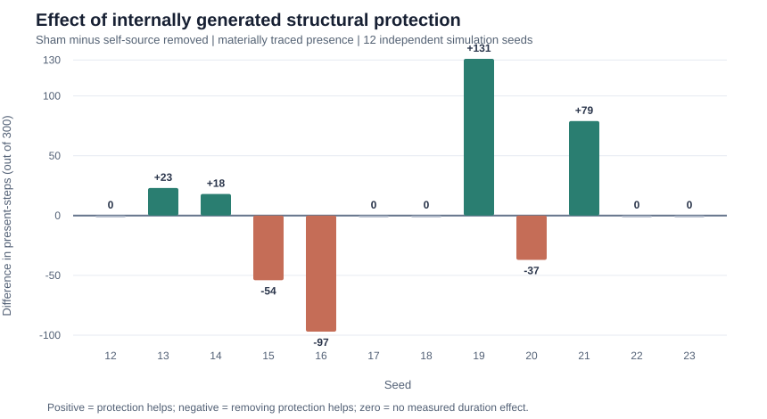

# Research Note 004 — The Conditions of Self-Maintenance

**Subtitle:** Catalytic Feedback, Structural Persistence, and the Search for Regenerative Organization

**Status:** VERIFIED SCIENTIFIC DRAFT — pending final regression-test output, editorial approval, and website publication. Full original machine-readable audit independently reconciled to every reported aggregate on 2026-11-13.
**Project:** ABIO — Computational Abiogenesis
**Scope:** E015 phases 1–6 and final mechanistic audit.
**Position:** Experimental research note, not evidence that artificial life has emerged.

## Abstract

When can a persistent organization become causally responsible for its own
continuation? We investigate an artificial reaction substrate with local
catalytic production and a transient protection field that changes bond-break
probabilities. Our simulations establish a mechanistic link between catalytic
activity and structural stabilization. Source-selective interventions identify
individual trajectories in which suppressing field deposition by a materially
traced organization shortens its persistence. But independent-seed evaluation
reveals heterogeneous effects, including cases where the same intervention
increases continuity. We distinguish local bond protection from the stronger
requirements of ongoing functional regeneration and organizational
self-maintenance.

The final mechanistic audit of seeds 12–23 corroborates the large change in bond-field exposure without a consistent benefit in material-bridge duration. We conclude that internally generated bond protection is an observable substrate-level mechanism, but that protection alone is insufficient evidence of regenerative organizational closure.

## 1. Persistence is not self-maintenance

We distinguish passive survival of a bond or structure from maintenance of a
causally persistent organization despite constituent turnover. Functional
continuity requires more than the persistence of an identity label and cannot
be inferred from protection alone. Note 004 asks whether, and under what
conditions, local catalytic activity helps preserve the producing
organization's material and functional continuity.

## 2. Model and intervention logic

E015 begins from a stochastic spatial particle-and-bond substrate. Local
productive catalytic bonds generate products and temporary field strength.
At a later step, field at bond endpoints reduces the break probability via:

\[
p_{\mathrm{break,eff}}=\frac{p_{\mathrm{break}}}{1+\alpha F_{\mathrm{local}}}
\]

where \(p_{\mathrm{break}}\) is the baseline bond-break chance,
\(\alpha\) is the model's protection strength and \(F\) is local
field. This is a deliberately specified substrate mechanism, **not**
an emergently discovered biological repair program.

Simulations create organizations from the substrate's local rules rather
than instantiating predefined organisms. Candidate identities are inferred
by bonded connected components and material overlap; they are heuristic.

## 3. Progression of experiments

### Field effects and broad continuity

The initial E015 comparison of disabled, spatially coupled and shuffled
field effects (12 seeds) demonstrated physical consequences but **did not**
show a consistent benefit of local coupling to the broad candidate-step
metric (local mean 7,901.83; disabled mean 7,922.00; shuffled mean 7,975.50).

### Matched post-formation intervention

At a shared step-300 checkpoint, continuation with local feedback produced
greater mean observation-steps of existing functional identities
(6.9935 original tracked IDs per step) than disabling field influence
(6.2163) or shuffling the field (6.6447). Between-seed uncertainty and
heuristic identity assignment prevented a definitive organization-level
interpretation.

### Source and ancestry auditing

A frozen original functional-ID source suppression failed to show consistent
causal dependence. Material-bridge tracing subsequently identified
contributions overlooked after lineage-ID changes: 177 catalytic births
were attributed to traced material successors across 12 seeds, and
10 bond-break trials were classified as prevented by self-attributed field
under fixed-state, same-random-draw comparisons. These are **local causal
opportunities**, not full trajectory-level proof.

### Dynamic self-source ablation

A dynamic intervention that followed the materially overlapping successor
revealed substantial losses of measured continuity in two already observed
trajectories: seed 2 (300 versus 109 postcheckpoint steps) and seed 3
(300 versus 197). Matched-draw bond-break thresholds identified a
first different bond outcome involving the material bridge in each.
These cases were identified retrospectively and cannot serve as independent
confirmation.

### Independent-seed assessment

Fresh seeds 12–23 yielded mean material-bridge presence 204.58 steps
with sham protection, 199.33 with material-bridge-source protection
deposition suppressed, and 207.67 with a timed off-target control.
The sham-minus-suppression differences were:

\[
[0, 23, 18, -54, -97, 0, 0, 131, -37, 79, 0, 0].
\]

Only four seeds favored sham, three favored removal, and five tied.
Mean benefit +5.25 steps, with wide uncertainty. The effect does
**not** establish a reliable population-level organization-survival
benefit. The control was closer in count and timing but not matched
for spatial field mass or bond exposure.

## 4. Final mechanistic audit: turnover, function, and resource context

The completed audit used the **same 12 seeds (12–23)** from the earlier
held-out evaluation, replayed from the same checkpoint under sham and dynamic
self-source suppression. These are **not twelve new replication seeds**.
Every instrumented sham reported a successful final physical-state parity
check against an independent uninstrumented E015 replay. The last audit's
unit-test suite has not been reported in the shared transcript.

| Mean per seed, steps 301–600 | Sham protection | Dynamic self-source removal |
|---|---:|---:|
| Material-bridge presence (steps) | 204.5833 | 199.3333 |
| Mean checkpoint-motif similarity, all steps | 0.37368 | 0.36187 |
| Mean checkpoint-motif similarity, conditional on presence | 0.54830 | 0.60341 |
| Mean active motif count, conditional on presence | 3.74136 | 3.62412 |
| Particles entering the material bridge | 34.3333 | 31.3333 |
| Particles departing the material bridge | 39.5000 | 37.6667 |
| Internal particle-ID bond gains | 34.5000 | 31.7500 |
| Internal particle-ID bond losses | 39.0000 | 37.3333 |
| Catalytic births assigned to the tracked bridge | 11.5000 | 11.5833 |
| Mean field at bridge sites, conditional on presence | 0.11506 | 0.01220 |
| Actual bridge bond-break trials | 467.0833 | 441.0833 |
| Field-exposed bridge bond-break trials | 198.6667 | 69.6667 |
| Actual bridge bond-break trials leading to breaks | 7.7500 | 7.5833 |
| Same-draw baseline-avoided break trials | 1.4167 | 0.3333 |
| Neighboring nutrient-site count, conditional on presence | 1.20663 | 1.22759 |

**Why the mechanistic audit matters.** Removing source deposits reduced the
mean observed protective field at the bridge sites by nearly an order of
magnitude and reduced field-exposed bond-break trials. The local physical
mechanism is thus exercised in the actual bridge risk set. This did **not**
translate into a consistent advantage in bridge persistence or catalytic
production. The average number of catalytic births assigned to the traced
bridge was essentially unchanged across the two arms.

The material-flow measures also offer no simple explanation. In the sham arm,
more particles entered and left traced components, and more internal
particle-ID bond pairs were gained and lost in absolute counts. But these
totals are affected by longer observation windows, changing component sizes,
mergers and losses. They cannot be read as direct rates of repair, uptake,
or autonomous regeneration.

In particular, higher *conditional* checkpoint-motif similarity in the
self-source-removed arm (0.60341 versus 0.54830) does not imply that field
protection reduces function: conditioning on bridge presence selects
different time windows and surviving organizational states.

### Contrasting individual outcomes

We intentionally retained all twelve outcomes. Among pronounced examples,
sham protected longer in seed **19** (217 versus 86 steps) and seed **21**
(131 versus 52). In contrast, removal preserved material connectivity longer
in seed **16** (169 versus 266) and seed **15** (246 versus 300).
Seed **12** retained the bridge for all 300 postcheckpoint steps in both
arms with identical monitored material-entry and departure counts (40, 34).
These divergent outcomes are findings to explain, not evidence for selecting
only positive trajectories.

A plausible—but **untested**—hypothesis is that protection helps when
maintaining productive local catalytic topology, while sometimes impeding
rearrangements or shifting later stochastic interactions. This study has
**not** established a predictive relationship between preintervention network
topology, regeneration rate and intervention benefit. Testing that mechanism
would require a separately prespecified, prospective design.

### Interpretation boundary

Bond exposure, material exchange and functional motif similarity are
different quantities. The simulation directly implements a rate change in
bond breaking; it does not provide an autonomous repair program, metabolic
constraint, energy accounting, self-generated boundary or closed RAF/CAF
verification. Therefore observed self-sourced protection cannot on its own
qualify as organizational self-maintenance.

## 5. Interpretation and limits

The demonstrated local mechanism is catalytic-field modification of
bond-break hazards. This can affect bonds on the actual traced
material component, yet its long-term organizational consequences are
strongly heterogeneous. Stabilization may preserve function in some
trajectories and alter later rearrangements in others. Explanations
involving productive turnover, boundary formation or resource flows
remain hypotheses pending direct controlled testing.

No formally demonstrated RAF/CAF closure, spatial compartmental
self-maintenance, heritable reproduction, or spontaneous artificial
organism is claimed.

## 6. Relation to prior research

Formal RAF (reflexively autocatalytic and food-generated) theory defines a
reaction subset by **catalytic support** and **generation of its reactants
from a specified food set**. Catalytic activity observed in our substrate
is not enough to infer either formal condition, and we have not extracted
or certified a realized RAF subnetwork. In particular, catalytic field
production that stabilizes a bond is conceptually distinct from producing
the constituents needed to maintain a reaction network. See Hordijk and
Steel (2019) and the formal algorithmic exposition by Hordijk (2023).

The distinction between RAFs and constructively autocatalytic and
food-generated (CAF) networks is likewise relevant: CAFs place additional
constructive ordering requirements on the availability of catalysts and
reactants. We make no CAF claim. Our experimental results instead focus on
**local physical consequences of production-linked structural protection**.

Work on emerging self-replicating programs in computational substrates
(Agüera y Arcas et al., 2024) illustrates a different level of life-like
organization: spontaneous replicators produced by program interaction.
Our experiment deliberately does not prespecify organisms, but it also
does not demonstrate self-replication, heredity or adaptive evolution.
It therefore addresses an earlier, weaker problem: when a local feedback
mechanism contributes causally to persistence.

These connections frame the present note; **they do not establish
publication novelty or a theorem extending RAF/CAF theory**. A formal
theoretical claim would require new definitions and proofs or independently
controlled experiments beyond the present scope.

**Selected references**

- Hordijk, W., & Steel, M. (2019). *Autocatalytic networks in biology:
  structural theory and algorithms.* Philosophical Transactions of the Royal
  Society B. https://pmc.ncbi.nlm.nih.gov/articles/PMC6408349/
- Hordijk, W. (2023). *A Concise and Formal Definition of RAF Sets and the
  RAF Algorithm.* https://arxiv.org/abs/2303.01809
- Steel, M., et al. (2020). *The structure of autocatalytic networks, with
  application to early biochemistry.*
  https://doi.org/10.1098/rsif.2020.0488
- Agüera y Arcas, B., et al. (2024). *Computational Life: How Well-formed,
  Self-replicating Programs Emerge from Simple Interaction.*
  https://arxiv.org/abs/2406.19108

## 7. A bounded conclusion

Note 004 focuses the distinction between **structural persistence** and
**causal organizational maintenance**. Evidence of internally generated
structural protection does not suffice to show a self-sustaining
organization. The next ABIO research stage should test explicit
regeneration and material/functional closure, rather than treating
lifespan alone as the success criterion.

## Publication requirements

- [x] Final 12-seed mechanistic audit executed and sham physics parity checks reported.
- [x] Final numeric audit findings integrated, all 12 seed-level duration effects preserved.
- [x] Governing field-break law checked against E015 code.
- [x] Mixed/negative findings retained, including both counterexamples and null outcomes.
- [ ] Confirm most recent Note004 unit tests were run successfully.
- [x] Add contextual RAF/CAF and computational-life references without claiming originality.
- [ ] Conduct a full independent novelty review before journal submission.
- [x] Add deterministic visual summary using reported seed-level paired outcomes.
- [x] Independently reconcile complete uploaded raw JSON (12 × 2 × 300 time-series records) against every per-seed and aggregate numeric summary, and verify figure's 12 seed differences.
- [x] Record raw JSON SHA-256 and a compact verified evidence archive in GitHub.
- [ ] Publish or separately deposit complete raw time-series JSON as a permanent public attachment (digest is committed; raw dataset is presently only available as investigator-uploaded source).
- [ ] Identify authorized ABIO website publishing integration and publish after review.

## Main figure

*Figure 1.* Sham minus dynamic self-source-suppressed material-bridge present-steps, seeds 12–23, postcheckpoint window 301–600. Positive values favor protection; negative values favor suppression. Figure constructed from the investigator's terminal summary, not independently archived raw JSON.

## Reproducibility and provenance

- Code repository: https://github.com/Dylanoshi/abio ; branch `e014-candidate-audit-v1`, E015 driver `track2/rco002/rco002_experiment015/note004_mechanistic_audit.py`.
- Output: `~/abio/track2/rco002/experiment015/results/note004_mechanistic_audit.json` on investigator workstation. **This file has not yet been copied to the GitHub repository or verified by the assistant.**
- E015 parameters: 24×24 lattice; 600 steps; checkpoint step 300; selected seeds 12–23; original E015 defaults unchanged; sham and dynamic self-deposition-removal arms.
- Selection: checkpoint prior 40-step catalytic activity, age, component size and ID; outcomes are measured from 301–600.
- The original uploaded JSON was checked in full: file size **7,384,244 bytes**, SHA-256 **95afd90dbe3baec7267b5969f6ba20df80898fc866eb1f5adb20ec965f05d147**. All 12 × 2 arm summaries reconcile with their 300-step observations, the seed-paired effects reproduce the figure, and the published aggregate means match the recomputed means. No accounting discrepancies were found.
- Compact validated summary and digest: `research_notes/004_verified_evidence_summary.json`. **Do not mistake this compact summary for the full raw 7.4 MB time-series JSON; the full raw file still needs a permanent public archive.**
- The observation and audit code is versioned; full raw simulation output and any figure-data exports should accompany public web release.
